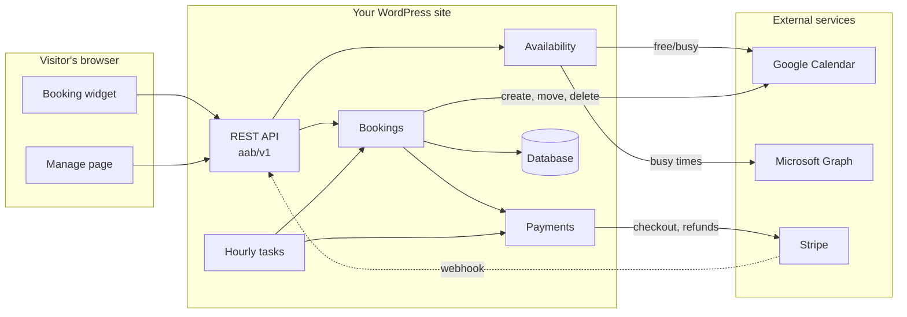
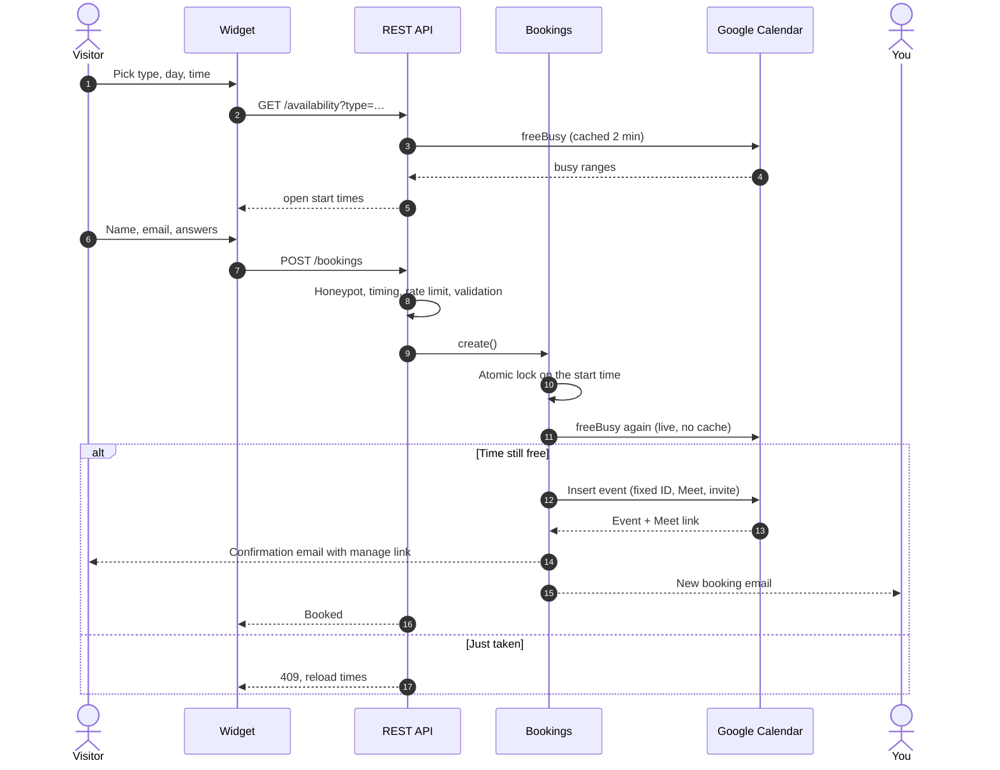
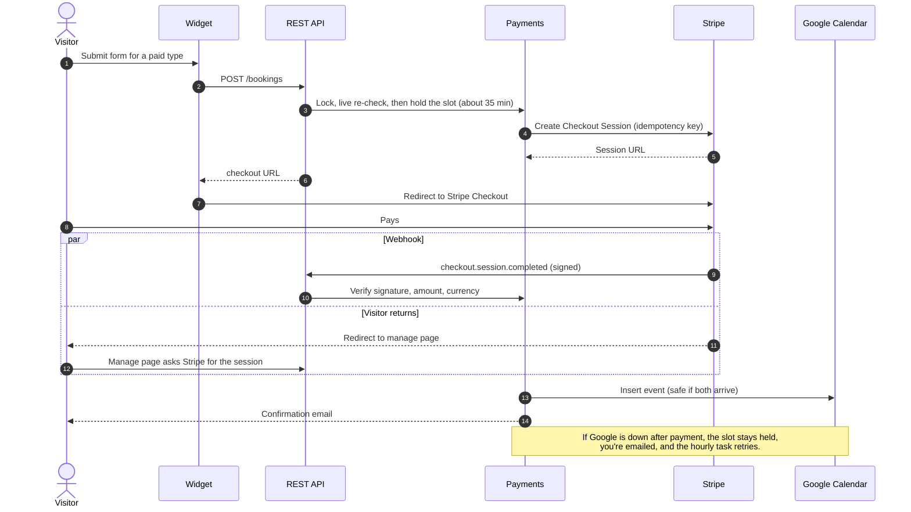
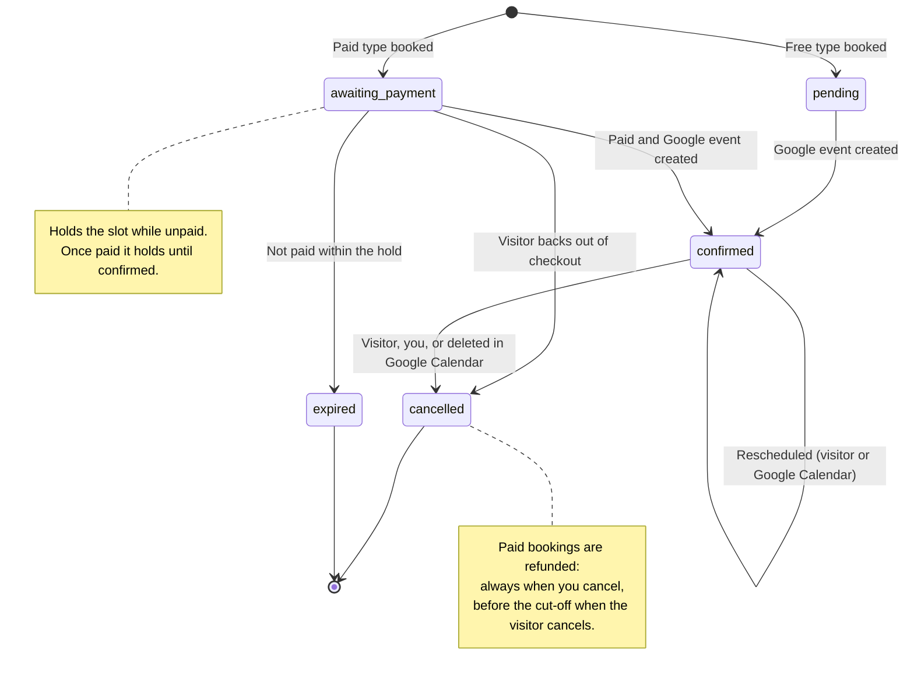
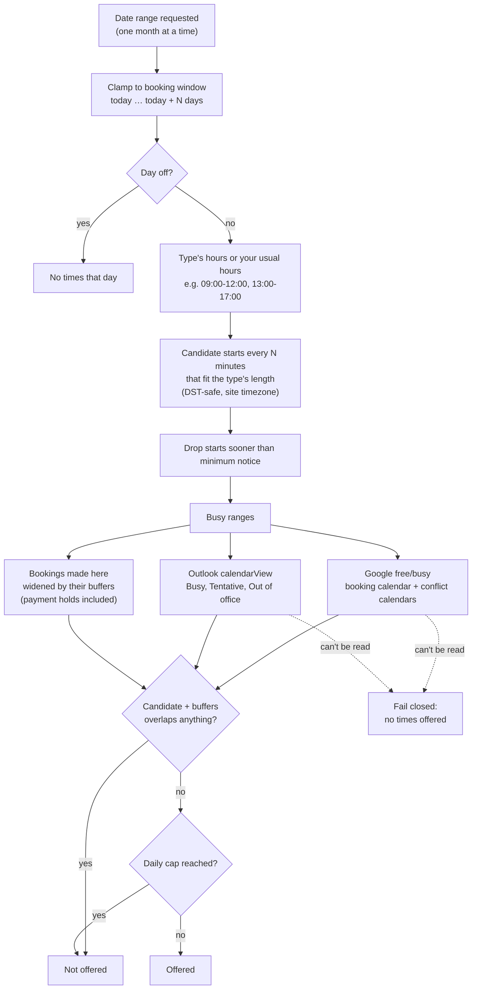
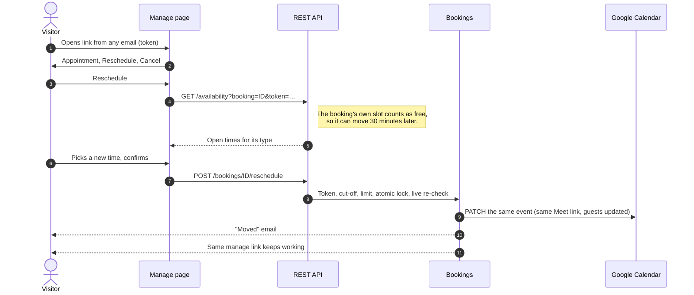
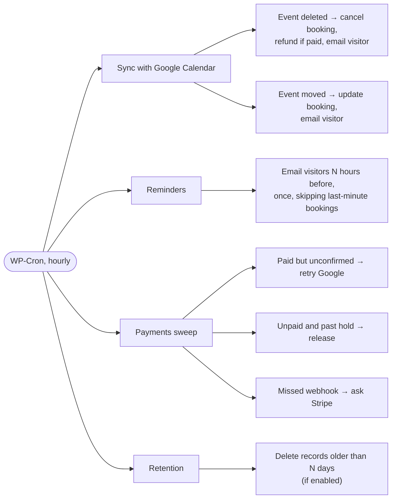
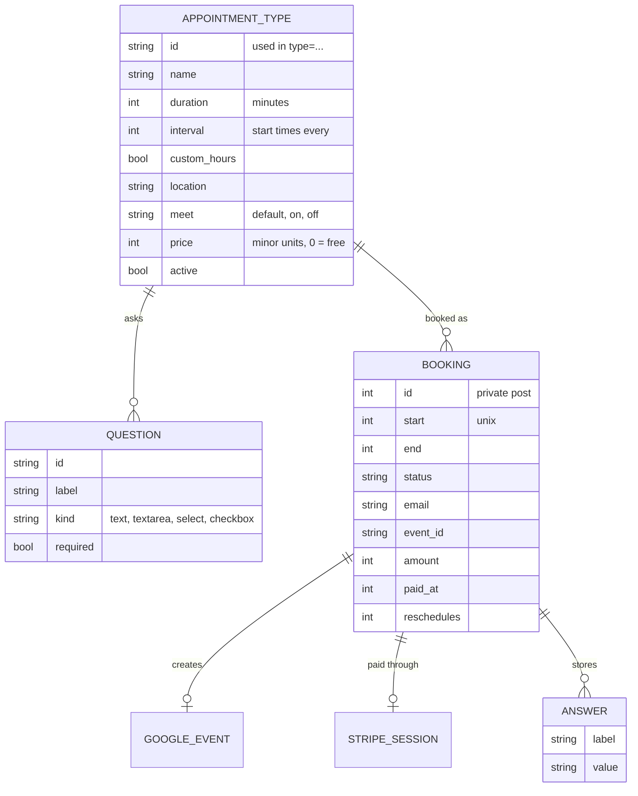
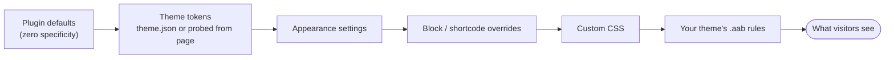

# Anderson Appointment Booking

[](https://github.com/CptNope/WordPress-Calendar-Sync-Plugin/actions/workflows/ci.yml)


Let visitors book appointments with you on your own WordPress site. Open times come live from your Google Calendar (and optionally Outlook), every booking lands in Google Calendar with a Meet link and invite, paid sessions go through Stripe, and the booking calendar looks like it was built for your theme.

**Every feature is free. No add-ons, no SaaS in the middle, no build step.**

## Contents

- [Why this plugin](#why-this-plugin)
- [Features](#features)
- [How it works](#how-it-works)
  - [Architecture](#architecture)
  - [Booking a free appointment](#booking-a-free-appointment)
  - [Booking a paid appointment](#booking-a-paid-appointment)
  - [Booking lifecycle](#booking-lifecycle)
  - [How open times are calculated](#how-open-times-are-calculated)
  - [Rescheduling](#rescheduling)
  - [Hourly background tasks](#hourly-background-tasks)
- [Requirements](#requirements)
- [Setup](#setup)
- [Appointment types](#appointment-types)
- [Settings reference](#settings-reference)
- [Styling](#styling)
- [Emails](#emails)
- [Developers](#developers)
- [Security and privacy](#security-and-privacy)
- [Running it in production](#running-it-in-production)
- [Troubleshooting](#troubleshooting)
- [Research and roadmap](#research-and-roadmap)

## Why this plugin

Built for solo professionals and small businesses who live in Google Calendar: consultants, freelancers, coaches, agencies, therapists, tutors. Compared with the usual WordPress booking plugins ([full research](docs/research/competitive-analysis.md)):

| | This plugin | Typical WordPress booking plugins (Oct 2026) |
| --- | --- | --- |
| Two-way Google Calendar | Free: live free/busy, events created, moves and deletions in Google mirrored back | Often paid: Amelia Pro, Bookly add-on, LatePoint paid tiers, Booknetic add-on |
| Stripe payments | Free, hosted Checkout, automatic refunds | Often an add-on or higher tier |
| Looks like your site | Reads your theme's colors, buttons, fonts and corners automatically | Plugin-styled widget; custom CSS expected |
| Double-booking protection | Atomic lock and live re-check at the moment of booking | Rarely documented |
| Outlook / Microsoft 365 conflicts | Free, recurring meetings included | Varies; often paid |
| Where your data lives | Your WordPress database and your Google account | Same for plugins; SaaS tools (Calendly, Cal.com) keep it on their servers |
| Weight on the page | About 14 KB of JavaScript and CSS (gzipped), no libraries, loaded only where the calendar appears | Varies; many ship their own frameworks |

## Features

| Area | What you get |
| --- | --- |
| **Availability** | Live free/busy from Google Calendar (several calendars), optional Outlook / Microsoft 365 calendars, weekly hours with breaks, days off, buffers before and after, minimum notice, booking window, daily cap |
| **Appointment types** | Each with its own length, start-time spacing, hours, location, Google Meet setting, price and booking questions; visitors pick a type, then a time |
| **Booking questions** | Short answer, long answer, dropdown, checkbox; required or optional; answers go to the Google event, emails, booking record and CSV |
| **Payments** | Stripe Checkout per type, the slot held while paying, confirmation after payment only, automatic refunds by policy |
| **Self-service** | One link in every email to reschedule (same calendar, own slot treated as free) or cancel, with a cut-off and a reschedule limit |
| **Google Calendar** | Events with visitor details, Meet links, guest invites; moves and deletions made in Google Calendar flow back within the hour |
| **Emails** | Confirmation (with a calendar file when Google isn't inviting), reminder, moved, cancelled with refund details, owner notices |
| **Design** | Theme matching for block and classic themes, live preview inside your theme, per-block and shortcode overrides, CSS variables, container-query layout, keyboard navigation |
| **Reliability** | Atomic slot lock, fails closed when a calendar can't be read, retries with backoff, idempotent Google and Stripe calls, Site Health checks, owner alerts |
| **Admin** | Bookings list with type, payment and status; CSV export; problem log; "Check Google Calendar now" |
| **Privacy** | Narrow OAuth scopes, secrets encrypted at rest, personal-data export and erase, automatic record clean-up |

## How it works

### Architecture



| Part | Role |
| --- | --- |
| Booking widget | Type picker, month calendar, times, form; theme-matched; about 14 KB gzipped |
| Manage page | Linked from every email: reschedule, cancel, finish or release a payment |
| Availability | Builds candidate times from hours and types, removes busy times, buffers, caps |
| Bookings | Atomic slot lock, live re-check, records, Google events, emails |
| Payments | Holds the slot, Stripe Checkout, confirmation, refunds |
| Hourly tasks | Google sync, reminders, payment sweep, retention |

### Booking a free appointment



### Booking a paid appointment

The slot is held while the visitor pays on Stripe's hosted page. Nothing is confirmed until Stripe says it's paid, and every confirmation path re-reads the payment from Stripe.



### Booking lifecycle



| Status | Holds the slot | Visitor can change it | Shown in bookings list as |
| --- | --- | --- | --- |
| `pending` | Briefly, while the Google event is created | No | Not confirmed |
| `awaiting_payment` | Yes, until the hold ends (forever once paid) | Pay or release from the manage page | Awaiting payment / Paid, adding to calendar |
| `confirmed` | Yes, plus its buffers on both sides | Reschedule or cancel until the cut-off | Confirmed / Past |
| `cancelled` | No | No | Cancelled / Deleted in Google Calendar |
| `expired` | No | No | Expired (not paid) |

### How open times are calculated



### Rescheduling



### Hourly background tasks



## Requirements

| | Minimum | Notes |
| --- | --- | --- |
| WordPress | 6.2 | |
| PHP | 7.4 | Tested in CI on 7.4 to 8.4; OpenSSL recommended (encrypts stored secrets) |
| Google account | Any | Personal Gmail or Google Workspace |
| Stripe account | Optional | Only for paid appointment types |
| Microsoft account | Optional | Work, school or personal, only for Outlook conflict calendars |
| Site timezone | A city | Fixed UTC offsets ignore daylight saving time; Site Health warns |

## Setup

Install the plugin (upload the zip under **Plugins → Add New**) and open **Appointments → Settings**. Each connection has step-by-step instructions on that screen with the exact URLs to copy.

### 1. Google Calendar (required)

| Step | Where | What to do |
| --- | --- | --- |
| 1 | [Google Cloud Console](https://console.cloud.google.com/apis/library/calendar-json.googleapis.com) | Create or pick a project, enable the **Google Calendar API** |
| 2 | Google Auth Platform | Choose **External**, fill in app name and email |
| 3 | Audience | **Publish app** so it's *In production* (apps left in *Testing* lose access after 7 days) |
| 4 | Clients | Create a **Web application** client with redirect URI `https://your-site/wp-admin/admin-post.php?action=aab_oauth` |
| 5 | Appointments → Settings | Paste client ID and secret, save, **Connect Google Calendar** |
| 6 | Appointments → Settings | Choose the booking calendar and conflict calendars, set your hours |

### 2. Appointment types

Open **Appointments → Appointment types** and add what visitors can book (see [Appointment types](#appointment-types)). Upgrading from 1.2 or earlier creates the first type from your old settings.

### 3. Stripe (optional, for paid types)

| Step | Where | What to do |
| --- | --- | --- |
| 1 | Stripe → Developers → API keys | Copy the **Secret key** (start with `sk_test_…`) |
| 2 | Stripe → Developers → Webhooks | Add endpoint `https://your-site/wp-json/aab/v1/stripe` with events `checkout.session.completed`, `checkout.session.expired`, `checkout.session.async_payment_succeeded`, `checkout.session.async_payment_failed` |
| 3 | Same page | Copy the **Signing secret** (`whsec_…`) |
| 4 | Appointments → Settings → Payments | Paste both, set currency and refund cut-off |
| 5 | Appointment types | Give a type a price |

Without the webhook, paid bookings still confirm when the visitor returns from Stripe or within the hour.

### 4. Outlook / Microsoft 365 (optional)

| Step | Where | What to do |
| --- | --- | --- |
| 1 | [Microsoft Entra](https://entra.microsoft.com/) → App registrations | **New registration**, accounts in any organizational directory **and** personal Microsoft accounts |
| 2 | Redirect URI | Platform **Web**: `https://your-site/wp-admin/admin-post.php?action=aab_ms_oauth` |
| 3 | API permissions | Microsoft Graph, delegated: `Calendars.Read`, `User.Read`, `offline_access` |
| 4 | Certificates & secrets | New client secret; note its expiry (24 months at most) |
| 5 | Appointments → Settings → Outlook | Paste the Application (client) ID and secret value, **Connect Outlook**, tick calendars |

### 5. Put the calendar on a page

| Method | Example |
| --- | --- |
| Block | **Appointment Booking** block; sidebar picks one type or all, plus style overrides |
| Shortcode, all types | `[anderson_booking heading="Book a call"]` |
| Shortcode, one type | `[anderson_booking type="consult"]` |

### Keeping secrets out of the database

Any of these in `wp-config.php` takes precedence over the settings screen:

```php
define( 'AAB_GOOGLE_CLIENT_ID', '…apps.googleusercontent.com' );
define( 'AAB_GOOGLE_CLIENT_SECRET', '…' );
define( 'AAB_STRIPE_SECRET_KEY', 'sk_live_…' );
define( 'AAB_STRIPE_WEBHOOK_SECRET', 'whsec_…' );
define( 'AAB_MS_CLIENT_ID', '…' );
define( 'AAB_MS_CLIENT_SECRET', '…' );
define( 'AAB_ENCRYPTION_KEY', 'a long random string' ); // optional: key for secrets stored in the DB
```

## Appointment types



| Per type | Shared by all types |
| --- | --- |
| Name, description | Buffers before and after |
| Length, start-time spacing | Minimum notice, booking window |
| Own weekly hours (or your usual ones) | Days off |
| Location, Google Meet on/off | Daily cap, per-person cap |
| Price | Change and refund cut-offs |
| Questions, notes box | Calendars checked for conflicts |
| Visible / hidden, order | Emails, styling |

Types share buffers and limits because one calendar holds one appointment at a time: a consult blocks intro calls in the same hour. Deleting a type keeps its bookings, which can still be rescheduled.

## Settings reference

| Setting | Default | Notes |
| --- | --- | --- |
| Usual hours | Mon–Fri 09:00-17:00 | 24-hour ranges, commas for breaks |
| Free time before / after | 0 / 15 min | Applied around new bookings and kept around existing ones |
| Minimum notice | 12 h | |
| Book up to | 30 days ahead | |
| Most bookings per day | 0 (no limit) | Counts payment holds |
| Upcoming bookings per person | 2 | By email address |
| Changes allowed until | 0 h before | Reschedule and cancel cut-off for visitors |
| Reschedules per booking | 0 (no limit) | |
| Days off | none | `2026-12-24` or `2026-12-24 to 2027-01-02`, `# notes` allowed |
| Calendar event title | `Appointment with {name}` | `{name}`, `{type}`, `{site}` |
| Location | empty | Types can override |
| Google Meet link | on | Types can override |
| Invite visitor as guest | on | Off: a calendar file is attached to emails instead |
| Phone number | Don't ask | Optional or required |
| Reminder email | 24 h before | 0 turns it off |
| Consent checkbox | empty | Text shown next to a required checkbox |
| Currency | USD | Payments |
| Refund visitor cancellations until | 24 h before | You cancelling always refunds |
| Keep booking records | 0 (forever) | Days after the appointment |
| Delete data on uninstall | off | Google events are never touched |

## Styling

The calendar always uses the surrounding page's font and text color. **Appointments → Settings → Appearance** adds a live preview rendered inside your actual theme.



| Option | "Match my theme" does | Or |
| --- | --- | --- |
| Accent color | Block themes: the theme's button color from theme.json (as a `--wp--preset--color--*` variable, so style variations follow). Classic themes: reads the real button or link color from the page | Any color, theme palette as swatches |
| Booking button and fields | The theme's own button and input styles | The calendar's own style in the accent color |
| Corners | The theme's button radius | Square, slightly rounded, rounded, very rounded |
| Background | None (page shows through) | The theme's page color, or any color |
| Spacing | | Compact, comfortable, roomy |
| Headings | The theme's heading font (block themes from theme.json, classic themes read from the page) | Same font as surrounding text |
| Custom CSS | | Loaded only on pages with the calendar |

### Shortcode attributes

| Attribute | Values | Example |
| --- | --- | --- |
| `heading` | Text | `heading="Book a call"` |
| `type` | An appointment type ID | `type="consult"` |
| `accent` | Hex color | `accent="#7c3aed"` |
| `background` | `none`, `theme`, hex color | `background="#faf5ff"` |
| `buttons` | `theme`, `plugin` | `buttons="plugin"` |
| `radius` | `auto`, `square`, `soft`, `rounded`, `round` | `radius="round"` |
| `density` | `compact`, `comfortable`, `roomy` | `density="compact"` |
| `headings` | `theme`, `inherit` | `headings="inherit"` |

### CSS variables

Declared at zero specificity, so a plain `.aab { … }` rule in your theme wins:

| Variable | Controls |
| --- | --- |
| `--aab-accent` / `--aab-on-accent` | Selected day, bars, links, plugin-style button / text on it |
| `--aab-radius` | Outer corners (controls derive smaller radii) |
| `--aab-space` | Spacing multiplier (0.75 to 1.3) |
| `--aab-surface` | Calendar box background |
| `--aab-text`, `--aab-muted` | Text and secondary text |
| `--aab-line`, `--aab-soft`, `--aab-tint` | Borders, open-day background, hover tint |
| `--aab-error` | Errors |
| `--aab-heading-font` | Month and panel titles |
| `--aab-max-width` | Widget width (none when the block is wide or full) |

Parts: `.aab__types`, `.aab__type`, `.aab__type-price`, `.aab__body`, `.aab__cal`, `.aab__month-label`, `.aab__nav`, `.aab__day` (`.is-open`, `.is-selected`), `.aab__bar`, `.aab__panel`, `.aab__time`, `.aab__form`, `.aab__field`, `.aab__input`, `.aab__submit`, `.aab__done`, `.aab__tz`. Calendar buttons are protected from theme `button` rules with `.aab:not(#aab-x) …`; use the same prefix, or the variables, to restyle them.

## Emails

| Email | To | When | Includes |
| --- | --- | --- | --- |
| Appointment booked | Visitor | Confirmed (after payment for paid types) | Type, time with timezone, Meet link or location, manage link, calendar file if not invited by Google |
| New booking | You | Confirmed | Contact details, answers, notes, Google Calendar link |
| Reminder | Visitor | N hours before (once) | Details and manage link |
| Appointment moved | Visitor (and you if the visitor moved it) | Rescheduled, or moved in Google Calendar | Old and new time, manage link |
| Appointment cancelled | Visitor (and you if the visitor cancelled) | Cancelled by anyone | Refund outcome for paid bookings |
| Booking offline | You | Google or Outlook access breaks (once per outage) | Reconnect link |
| Paid booking waiting | You | Paid but Google unreachable | Retried hourly |
| Refund needed | You | Automatic refund failed | Amount and visitor, to refund in Stripe |

Google Calendar also emails invited guests its own invites and updates.

## Developers

### REST API (`/wp-json/aab/v1`)

| Method and route | Purpose | Auth |
| --- | --- | --- |
| `GET /availability?from&to&type` | Open start times per day for a type (max six weeks) | Public, rate-limited |
| `GET /availability?from&to&booking&token` | Same, for rescheduling a booking (its own slot counts as free) | Emailed token |
| `POST /bookings` | Book (`start`, `name`, `email`, `type`, `answers`, `phone`, `notes`, `consent`); returns the booking or a Stripe `checkout` URL | Public, honeypot, timing, rate-limited |
| `POST /bookings/{id}/reschedule` | Move a booking (`start`, `token`) | Emailed token |
| `POST /stripe` | Stripe webhook | Stripe signature |

### Hooks

| Hook | Type | Arguments |
| --- | --- | --- |
| `aab_booking_confirmed` | action | `$booking` |
| `aab_booking_rescheduled` | action | `$booking`, `$old_start` |
| `aab_booking_cancelled` | action | `$booking`, `$by` (`visitor`, `admin`, `calendar`) |
| `aab_client_ip` | filter | `$ip`, `$remote_addr` |
| `aab_enqueue_styles` | filter | `$load` (return `false` to style everything yourself) |
| `aab_style_vars` | filter | `$vars`, `$overrides` |
| `aab_theme_tokens` | filter | `$tokens` |

### File map

| Piece | File |
| --- | --- |
| Bootstrap | `anderson-appointment-booking.php` |
| Google OAuth and Calendar v3 | `includes/class-aab-google.php` |
| Microsoft Graph (Outlook) | `includes/class-aab-microsoft.php` |
| Stripe client | `includes/class-aab-stripe.php` |
| Paid booking flow | `includes/class-aab-payments.php` |
| Slot engine | `includes/class-aab-availability.php` |
| Bookings, locks, emails, calendar files | `includes/class-aab-bookings.php` |
| Appointment types and answer validation | `includes/class-aab-types.php` |
| REST API | `includes/class-aab-rest.php` |
| Shortcode, block, manage page, preview | `includes/class-aab-frontend.php` |
| Theme detection and style resolution | `includes/class-aab-style.php` |
| Hourly tasks and Site Health | `includes/class-aab-maintenance.php` |
| Admin screens | `includes/class-aab-admin.php`, `includes/class-aab-admin-types.php`, `includes/views/` |
| Widget | `assets/js/booking.js`, `assets/css/booking.css` |
| Block | `blocks/booking/` |
| Translations template | `languages/anderson-appointment-booking.pot` |

### Development

No build step: edit and reload. CI (GitHub Actions) checks PHP syntax on 7.4 to 8.4 and JavaScript syntax on every push. Release zips come from `git archive`, which leaves out `docs/`, `.github/` and this README (see `.gitattributes`).

## Security and privacy

| Concern | How it's handled |
| --- | --- |
| Google, Stripe and Microsoft secrets | AES-256-GCM encrypted at rest (key from WordPress salts or `AAB_ENCRYPTION_KEY`), or kept in `wp-config.php` |
| Google scopes | `calendar.events`, `calendar.freebusy`, `calendar.calendarlist.readonly` only |
| Microsoft scopes | `Calendars.Read`, `User.Read`, `offline_access` (read-only) |
| Event details from conflict calendars | Never read: free/busy (Google) and start, end, show-as (Outlook) only |
| Card data | Never touches your site: Stripe-hosted Checkout |
| Payment confirmation | Webhook signature (HMAC-SHA256, 5-minute tolerance) and amount/currency checked; return URLs re-check with Stripe |
| Double charges or refunds | Stripe idempotency keys on every write |
| Visitor links | 32-character random token, stored hashed; cancel needs a POST so mail scanners can't trigger it |
| Spam | Honeypot, minimum form time, per-IP rate limits that see the real IP behind private proxies only |
| OAuth | `state` checked on Google and Microsoft sign-in |
| Admin actions | Capability checks and nonces |
| Output | Escaped; data rendered with `textContent` in the widget |
| CSV export | Formula injection neutralized |
| Personal data | WordPress export and erase tools; optional automatic deletion after N days |

## Running it in production

| Topic | Notes |
| --- | --- |
| Proxies and caches (Cloudways/Varnish, nginx, Cloudflare) | Real visitor IP read from `CF-Connecting-IP`, `X-Real-IP`, `X-Forwarded-For` only when PHP is reached from a private or loopback address. Page caching is fine: times load through the REST API with `Cache-Control: no-store` |
| WP-Cron disabled | Add a server cron job that requests `wp-cron.php` every few minutes; Site Health warns if the hourly task stops |
| Google access breaks | Booking stops safely, one owner email, wp-admin notice until reconnected |
| Outlook access breaks | Same: times aren't offered without it; Site Health turns critical |
| Transient failures | Google, Stripe and Microsoft calls retry with backoff; Google events use fixed IDs so retries never duplicate |
| Concurrency | Six simultaneous requests for one slot: exactly one booking, one Google event (tested) |
| All-day events | *Free* by default in Google Calendar and don't block; mark them *Busy* or use **Days off** |
| Stripe test vs live | Test keys show "test mode" on the settings screen; switch keys when you go live and re-create the webhook in live mode |
| Logs | Recent Google, Stripe and Microsoft errors on the settings page |

## Troubleshooting

| Symptom | Likely cause | Fix |
| --- | --- | --- |
| "Online booking is unavailable" | Google not connected or access expired | Reconnect under Appointments → Settings |
| Booking stops working every 7 days | Google OAuth app left in *Testing* | Publish the app to *In production*, reconnect |
| No times shown at all | Outlook or Google can't be read (fails closed), or every day is outside hours, notice or window | Check the problem log and Site Health |
| Vacation days still bookable | All-day events are *Free* in Google Calendar | Mark them *Busy*, or add to Days off |
| Paid type doesn't appear | Stripe keys missing | Set up Payments; the types screen warns about this |
| Paid booking stuck on "Paid, adding to calendar" | Google unreachable after payment | Nothing to do: retried hourly, you were emailed |
| Visitor paid but wasn't confirmed instantly | Webhook not set up, or async payment method | Confirms on return or within the hour |
| Times off by an hour twice a year | Site timezone is a UTC offset | Settings → General → choose a city |
| Reminders not sent | WP-Cron not running | Add a server cron job; Site Health tells you |
| "Refund needed" email | Automatic refund failed | Refund in the Stripe dashboard |

## Research and roadmap

- [Competitive analysis](docs/research/competitive-analysis.md): how the WordPress booking plugins compare, with sources
- [Roadmap](docs/ROADMAP.md)

## License

MIT © Jeremy Anderson

---

Built by [Jeremy Anderson Tech](https://jeremyanderson.tech/), a web development and security practice in Shrewsbury, MA. [Services](https://jeremyanderson.tech/services/)
